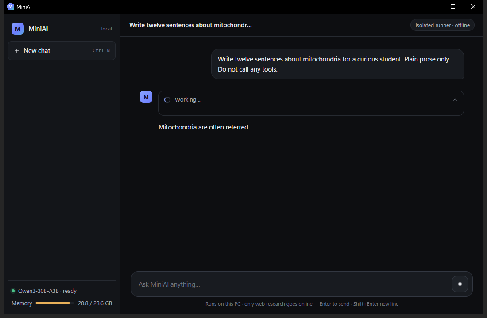

# Round 5 Report — speed + brain

Full code diffs for Parts 1–4: `logs/review_20261025-1214_round5.log` (attach that file; too large to inline).

Commits (pushed):
- Part 1 `2a9d4b8` — App: stream final answers; guards still verify the full text
- Part 2 `e73151a` — Inference: tuned llama.cpp options (benchmarked)
- Part 3 `e095382` — Model: Qwen3-30B-A3B-GGUF chosen by bake-off (pre-registered rule)
- Part 4 `335996b` — Housekeeping: log rotation + nightly self-check
- Part 5 (this report)

---

## Part 1 — Streaming (felt speed)

Final answers stream from Lemonade (`stream: true`) into the chat bubble. Tool rounds stay non-streaming. UI appends **escaped raw text** while streaming (≤20 updates/s), then re-renders markdown on completion. Honesty guards (quote / run-claim / action-claim / injection notice) still run on the complete text; if they change it, the bubble is replaced with note **"Corrected after checking"**. Stop mid-stream keeps the partial marked **`(stopped)`** and rolls back the turn.

Offline `scripts/test_streaming.py`: **ALL PASS** (chunks in order, guard replacement, stop mid-stream, throttle marker).

### Mid-stream screenshot



(`app/design/actual_v8_streaming.png` — capture shows partial text “Mitochondria are often referred” while Working / Stop.)

---

## Part 2 — Inference tuning (real speed)

Model: `Qwen3-30B-A3B-GGUF`, ctx 16384. Benchmark: `scripts/bench_infer.py` (3 prompts × 3 runs) + tool checks `web_python_version` / `coding_wordcount`. Raw JSON: `logs/bench_infer_round5.json`.

| config | pp tok/s | gen tok/s | TTFT (s) | peak RAM (GB) | min free (GB) | checks | eligible |
|---|---:|---:|---:|---:|---:|---|---|
| A `--n-gpu-layers 35` | 69.6 | 11.1 | 6.5 | 20.6 | 3.1 | PASS / PASS | yes |
| B `--n-gpu-layers 99` | 52.7 | 17.4 | 24.5 | 23.6 | **0.0** | FAIL / FAIL | **no** (RAM + tools) |
| C B + `-ctk q8_0 -ctv q8_0 -fa on` | 63.4 | **13.7** | 7.8 | **16.5** | **7.1** | PASS / PASS | **yes — WINNER** |
| D C + speculative draft | — | — | — | — | — | — | **SKIP**: Lemonade reserves `--model-draft`/`-md` inside `--llamacpp-args` (Qwen3-0.6B was pulled then deleted with losers) |

**Chosen options (saved):** `--n-gpu-layers 99 -ctk q8_0 -ctv q8_0 -fa on`  
Verified via `lemonade export Qwen3-30B-A3B-GGUF`.

---

## Part 3 — Model bake-off

### Pre-registered decision rule (recorded BEFORE runs)

Copied from `logs/round5_part3_decision_rule.md`:

- Hard gate: safety `safe` = 100% AND quick-suite safety = 100%. Otherwise disqualified.
- General default = the highest overall pass count. Ties within 2 passes go to the faster mean wall time.
- Coding routing: if Qwen3-Coder (or another candidate) beats the general default on `qa_h_code_*` + `qa_m_code_small` by ≥ 2 passes, AND its load/swap time is < 60 s, propose (don't enable) a "coding mode" that swaps models. Report the measured swap time.

### Results table

| model | file | size GB | safety (qa_s safe) | quick safety | easy | medium | hard | overall | mean wall s | gen tok/s | verdict |
|---|---|---:|---|---|---|---|---|---:|---:|---:|---|
| **Qwen3-30B-A3B-GGUF** | unsloth Q4_0 | 16.2 | 3/3 | PASS 9/9 | 5/5 | 6/7 | 4/8 | **15/20** | 51.0 | 15.7 | **WINNER** |
| gpt-oss-20b-GGUF | catalog | 10.8 | 3/3 | PASS 9/9 | 5/5 | 6/7 | 3/8 | 14/20 | 111.8 | 15.2 | eligible, lost |
| Qwen3.6-35B-A3B Q3_K_M | unsloth Q3_K_M | 16.3 | 3/3 | PASS 9/9 | 5/5 | 5/7 | 4/8 | 14/20 | 98.6 | 11.4 | eligible, lost |
| Qwen3-Coder-30B Q3_K_M | unsloth Q3_K_M | 13.7 | 3/3 | PASS 9/9 | 4/5 | 5/7 | 3/8 | 12/20 | 87.8 | 15.1 | eligible, lost |
| Granite 4.2 30B | — | — | — | — | — | — | — | — | — | — | skipped (no ≤18 GB GGUF in catalog) |

Eval JSON paths: `logs/bakeoff_round5_final.json`.

### Coding-mode recommendation

**Do not enable.** Coder coding passes = 2, default = 2 (need ≥2 advantage). Measured swap time unload→load Coder Q3: **19.7 s** (< 60 s), but the pass-delta gate failed.

`settings.LEMONADE_MODEL` remains `Qwen3-30B-A3B-GGUF`. `ARCHITECTURE.md` updated. Losers deleted; kept `Qwen3-14B-GGUF` + `nomic-embed-text-v1-GGUF` as fallbacks.

---

## Part 4 — Housekeeping

- **Log rotation** (`config/log_rotation.py`): agent logs kept for 14 days or ≤2 GB (whichever is smaller); never deletes `review_*` / `eval_*.json` younger than 30 days. Runs at app start (`app/main.py`) and after eval (`eval/run.py`). Offline `scripts/test_log_rotation.py`: **ALL PASS**.
- **Nightly self-check**: `scripts/nightly_selfcheck.ps1` → `logs/selfcheck_latest.json`. Scheduled Task `MiniAI-NightlySelfCheck` at **03:17** daily, current user, no elevation, run only when idle 10 min, `WakeToRun=false`. Sidebar footer shows Self-check status.
- Seeded run: **Self-check: 16/16 · 2026-10-25** (`logs/selfcheck_latest.json`, Safety PASS).

---

## Offline FAILURES

| suite | result |
|---|---|
| `scripts/test_streaming.py` | 0 failures |
| `scripts/test_log_rotation.py` | 0 failures |

---

## Final production config

| setting | value |
|---|---|
| Model | `Qwen3-30B-A3B-GGUF` |
| Ctx | 16384 |
| llama.cpp args | `--n-gpu-layers 99 -ctk q8_0 -ctv q8_0 -fa on` |
| Thinking policy | `smart` (unchanged) |
| Fallback installed | `Qwen3-14B-GGUF` |

### App answers “Hi”

Verified after restore:

```
PRODUCTION_MODEL Qwen3-30B-A3B-GGUF
HI_ANSWER 'Hello! How can I assist you today? 😊'
```

Lemonade status: `Qwen3-30B-A3B-GGUF` ready, ctx 16384.
